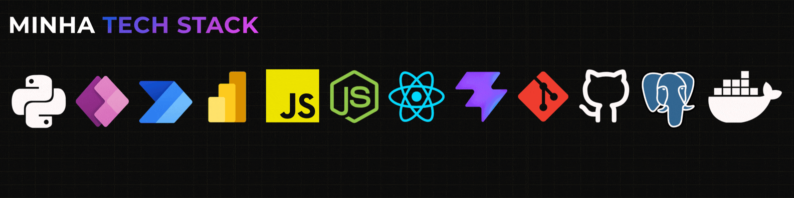
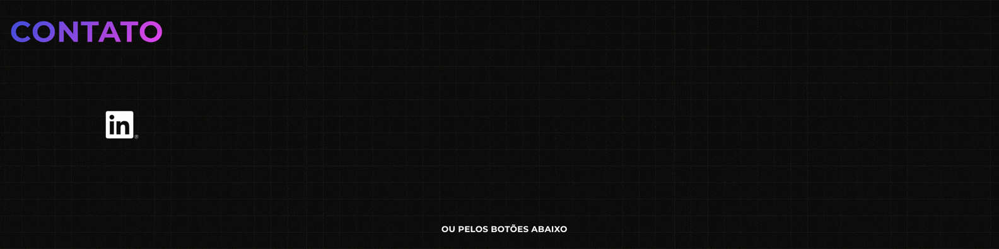

  

  
Crio experiências web, automações e soluções orientadas por dados — com foco em interfaces claras, código sustentável e entregas confiáveis.

  

 

---

<h2><code>&gt; SOBRE_MIM</code></h2>

Atuo no desenvolvimento de aplicações web, automações e projetos de dados. Gosto de transformar ideias em produtos úteis, combinando boa experiência de uso, organização técnica e evolução contínua.

 

  

<table>
  <tr>
    <td valign="top">
      <h3><code>DESENVOLVIMENTO_WEB</code></h3>
      
      
      
      
      
      
      
      
    </td>
  </tr>
  <tr>
    <td valign="top">
      <h3><code>DADOS_E_AUTOMAÇÃO</code></h3>
      
      
      
      
      
      
      
    </td>
  </tr>
  <tr>
    <td valign="top">
      <h3><code>DEVOPS_E_FERRAMENTAS</code></h3>
      
      
      
      
      
      
    </td>
  </tr>
</table>

 

  

<table>
  <tr>
    <td width="50%" valign="top">
      <h3><a href="https://love.thigasfal.dev">LOVE.THIGASFAL.DEV</a></h3>
      
<code>STATUS: EM DESENVOLVIMENTO</code>

      
Projeto autoral em evolução contínua. Novas experiências, recursos e melhorias estão sendo construídos e publicados gradualmente.

      <code>React · TypeScript · Vite</code>
    </td>
    <td width="50%" valign="top">
      <h3><a href="https://thigasfal.dev/flappyBird/">FLAPPY BIRD — CLONE</a></h3>
      
<code>STATUS: ONLINE</code>

      
Clone jogável desenvolvido com Phaser. Clique ou pressione espaço para voar e superar os obstáculos.

      <code>JavaScript · Phaser · HTML5</code>
    </td>
  </tr>
  <tr>
    <td width="50%" valign="top">
      <h3><a href="https://github.com/thiagofal1/inventory-control">INVENTORY CONTROL</a></h3>
      
<code>STATUS: CONCLUÍDO</code>

      
Aplicativo corporativo de controle de estoque com SharePoint e Power Fx, desenvolvido para operações corporativas.

      <code>Power Apps · SharePoint · Power Fx</code>
    </td>
    <td width="50%" valign="top">
      <h3><a href="https://captura.thigasfal.dev">CAPTURA</a></h3>
      
<code>STATUS: EM DESENVOLVIMENTO</code>

      
Gravador de tela no navegador sem uploads ou marcas d’água, com processamento 100% local e foco em privacidade.

      <code>HTML5 · CSS3 · JavaScript</code>
    </td>
  </tr>
  <tr>
    <td width="50%" valign="top">
      <h3><a href="https://github.com/thiagofal1/spotifyFamily">SPOTIFY FAMILY</a></h3>
      
<code>STATUS: CONCLUÍDO</code>

      
Case de automação local integrando n8n, Docker, Google Sheets e Evolution API para organizar pagamentos e notificações.

      <code>n8n · Docker · Google Sheets · Evolution API</code>
    </td>
    <td width="50%" valign="top">
      <h3><a href="https://maxtronbot.tech">DJ MAXTRON</a></h3>
      
<code>STATUS: ONLINE</code>

      
Bot de música e entretenimento para Discord com suporte a YouTube/Spotify, economia e cartões de perfil dinâmicos.

      <code>Node.js · Discord.js · SQLite · Playwright</code>
    </td>
  </tr>
</table>

 

  

  
  
  
  
  

 

---

<code>thigasfal.dev © 2026</code>

